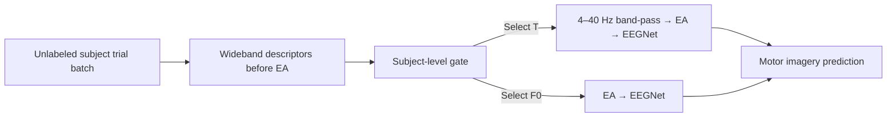

# MI EEG Spectral Gating

Subject-level selection of spectral preprocessing for cross-subject motor imagery EEG decoding.

Research code accompanying the manuscript **Spectrally Adaptive EEG Decoding for Cross-Subject Motor Imagery**.

## Overview

A fixed spectral preprocessing strategy can affect subjects differently. This work uses descriptors from an unlabeled target-subject trial batch to choose between two complete preprocessing–decoding pipelines:

| Pipeline | Additional band-pass | Alignment | Decoder |
| --- | --- | --- | --- |
| T | Fourth-order, zero-phase 4–40 Hz Butterworth | Euclidean alignment (EA) | EEGNet |
| F0 | Omitted | EA | EEGNet |

The pipelines have separately trained decoder weights. F0 retains acquisition filtering; omitting the additional band-pass does not mean the EEG is unfiltered.



Gate settings are fitted separately for the two external datasets:

| Dataset | Active descriptors | Gate |
| --- | --- | --- |
| OpenBMI | 20 | Gradient boosting with conservative dual thresholds |
| PhysioNet | 8 | Class-balanced logistic regression with a 0.01 switching-gain target |

The manuscript reports mean accuracy gains of **2.419 percentage points on OpenBMI** and **1.546 percentage points on PhysioNet**, relative to the better fixed global strategy in each dataset. The evaluation conditions are described below.

This repository contains source code, configurations and interface tests. Raw EEG, derived result data, trained models and manuscript files are maintained separately.

## Getting started

Use Python 3.10 or newer. Clone the repository and install in your own environment:

```powershell
git clone https://github.com/zichuanwcy/mi-eeg-spectral-gating.git
cd mi-eeg-spectral-gating
python -m pip install -e .
mi-eeg --help
mi-eeg list-configs
python -m unittest discover -s tests -v
```

Dependencies are listed in `requirements.txt`. The original training environment lock is unavailable; a fully tested scientific environment has not been established for this release. Use a PyTorch build suitable for your machine.

The source entries can be inspected before installation:

```powershell
python train.py --help
python train.py --experiments OpenBMI_Traditional OpenBMI_F0 --data-dir data/raw --output-dir results/decoders --dry-run
python extract_features.py --data-dir data/raw --output-dir data/derived/descriptors --dry-run
```

`--dry-run` prints settings and paths without importing scientific backends or creating outputs. Remove it to execute the task. Use a new or empty output directory.

## Repository structure

```text
├── train.py                   # Decoder training
├── extract_features.py        # Subject descriptor extraction
├── evaluate.py                # Repeated gate evaluation
├── configs/                   # Actual parameters, grouped by dataset
├── src/mi_eeg/
│   ├── config.py              # JSON loading and validation
│   ├── cli.py                 # Command-line interface
│   ├── data/                  # Dataset loaders and input preparation
│   ├── preprocessing/         # Filtering, EA and subject descriptors
│   ├── models/                # EEGNet and structural controls
│   ├── training/              # Decoder training and logging
│   ├── gating/                # Subject-level gates
│   └── evaluation/            # Metrics, summaries and analysis
├── scripts/                   # Input joining, summaries and historical plots
└── tests/                     # Configuration and interface checks
```

The three files `configs/bci2a.json`, `configs/openbmi.json` and `configs/physionet.json` contain the actual decoder settings: 19 BCI configurations and 6 external-dataset configurations. Use `--config-dir PATH` with `train.py` or `mi-eeg list-configs` to load another configuration folder. `configs/paths.example.json` illustrates paths; it is not loaded automatically.

Experiment IDs are retained for correspondence with the manuscript and archived outputs. Computational controls include fixed bands, EA, SE attention and matched two/three-branch EA comparisons.

## Data and gate inputs

Obtain each dataset from its provider under its access and reuse terms:

- [BCI Competition IV, dataset 2a](https://www.bbci.de/competition/iv/)
- [OpenBMI, GigaDB](https://gigadb.org/dataset/100542) — DOI: 10.5524/100542
- [PhysioNet EEG Motor Movement/Imagery, v1.0.0](https://physionet.org/content/eegmmidb/1.0.0/) — DOI: 10.13026/C28G6P

The BCI loader expects compatible `A01T.mat`/`A01E.mat` through `A09T.mat`/`A09E.mat` in `data/raw/`. OpenBMI and PhysioNet loaders use `data/raw/openbmi/` and `data/raw/physionet/`. The MOABB acquisition helper is supplied, but its conversion has not been verified as identical to the historical conversion. Raw-data hashes are unavailable.

Preserve the study's source versions, channels, trial windows and subject exclusions. Descriptor extraction uses wideband pre-EA trials, matched channels and a synchronized unlabeled reference cohort. Reference-distance descriptors depend on that cohort.

Gate evaluation requires matching fixed T/F0 outcomes and descriptor CSVs. Join prepared records with:

```powershell
python scripts/prepare_inputs.py --delta-csv data/derived/subject_delta_all.csv --descriptor-csv data/derived/all_descriptors.csv --output-dir data/derived/gate_inputs --dry-run
```

The join validates unique dataset/subject keys and the study subsets of 54 OpenBMI and 105 PhysioNet subjects. It writes `openbmi_gate_dataset.csv` and `physionet_gate_dataset.csv`. Outcome labels are evaluation targets, not inference descriptors. These CSVs are not bundled.

## Gate evaluation and summaries

```powershell
python evaluate.py --results-dir results/decoders --gate-dir data/derived/gate_inputs --output-dir results/gates --dry-run
python scripts/summarize_results.py --input-dir results/gates --output-dir results/gate_summary --dry-run
```

The evaluation backend expects the original `stage4/` and `stage5/` input schemas under `--results-dir`. `mi_eeg.evaluation.pipeline_outcomes` contains the historical log parser and reads selected logs directly under its input directory. These commands require prepared inputs; they do not form a single-command raw-data-to-paper workflow.

Removing `--dry-run` from `evaluate.py` fits gate classifiers using stratified five-fold cross-validation with seeds 20260710–20260714. The summary selects the recorded dataset-specific candidates from per-repetition `baselines/` and `risk/` outputs, without selecting a new winner for each seed. Auxiliary `gate_subjects` diagnostics are separate from the final gate summaries.

## Evaluation scope and verification

- The external-dataset decoders use three subject folds repeated with five seeds. Held-out target labels were used for monitoring and checkpoint selection.
- OpenBMI SE has six completed matched folds from seeds 42/43. Its configuration can be inspected with `--dry-run`; the normal training entry does not expand this partial result into five repetitions.
- The gate inputs come from unlabeled target-subject batches and the synchronized reference cohort. Gate settings are dataset-specific; cross-dataset gate transfer was not evaluated.
- Historical summary helpers use percentile bootstrap and legacy one-sided tests. They do not reproduce the manuscript's subject-level BCa intervals and two-sided tests. The exact original BCa generator, seed/input-freeze record, cloud commit and hardware/environment manifest have not been recovered.
- The historical plot helper uses frozen CSV schemas and does not recreate the final author-revised figures.

Syntax, configuration consistency, interface tests and local package installation were checked with Python 3.12. Full decoder training, gate fitting and end-to-end numerical reproduction have not been rerun for this release.

## License

Original project code and documentation are available under the [PolyForm Noncommercial License 1.0.0](LICENSE). Permitted uses include noncommercial purposes and the educational, public research and other organizational uses expressly listed in the license, regardless of their funding source. Uses outside that grant require separate permission from the relevant rights holder. Read the license for the full terms.

Third-party material retains its original license. See [NOTICE](NOTICE) for attribution and scope, including the [EEG-TCNet Apache-2.0 license](licenses/EEG-TCNet-Apache-2.0.txt).

## Acknowledgments

The normalization module references [EEG-TCNet](https://github.com/iis-eth-zurich/eeg-tcnet). The EEGNet model source retains its method citation. The reviewed upstream reference and its license are recorded in [NOTICE](NOTICE).

## Questions

Please use GitHub Issues for questions about the code.
